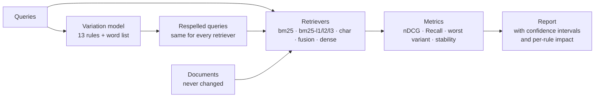

# Hijje

**Measuring, and fixing, what happens to search when Roman Urdu is spelled differently**

*Hijje* (ہجے) is the Urdu word for "spelling". The name itself can be written
hijje, hijjay or hijay, which is the problem this project studies.

> **Status: v0.4, a tested research instrument with a first real-text result.**
> New in 0.3: respelling that uses only spellings people wrote, and a test
> collection of 9,759 human-written sentences. New in 0.4: the normalisers are
> measured directly on 30,000 human-spelled words, a fifth normaliser (level 4: vowel classes)
> and a test of how query length changes the picture. The results are a first
> look, not a finished study. What is missing before a paper is listed under
> [Limitations](#limitations) and in [docs/RESEARCH_PLAN.md](docs/RESEARCH_PLAN.md).

---

## The problem

Roman Urdu is Urdu typed in Latin letters. It has no standard spelling. One
person writes "nahi", the next "nhi", a third "nahin", and all three are
correct. Search engines and RAG systems assume each word has one spelling.

Here is what that assumption costs, on a real run of this code. The passage
being searched for is:

> *Machharon se bachne ke liye ghar ke aas paas khara pani jama na hone dein…*

| What the user typed | Exact-match search (BM25) | BM25 with phonetic normalisation |
|---|---|---|
| machharon se bachne ka tareeqa | finds it, rank 1 | finds it, rank 1 |
| macharon say bachny ka tariqa | **does not find it at all** | finds it, rank 1 |

Both lines are the same question. In the second, the only word that still
matches anything letter for letter is "ka", so exact-match search returns 22
passages that merely contain "ka", and the right passage is not among them. A
RAG system built on it would then answer from the wrong passages, and nothing
in the system would report an error.

## Why this project

**Who is affected.** Very large numbers of people write Urdu in Latin letters
every day in chat, comments, search boxes and customer-support messages. The
more informally someone types, the worse today's systems serve them.

**Why existing tools fail.** Lexical search matches exact tokens, so a
respelled word is simply a different word to it. Neural embedding models break
an unfamiliar spelling into subword pieces; whether the result still lands
near the right passage is something that has to be measured, and for Roman
Urdu it has not been. Neither kind of system was designed for a language where
spelling is a personal choice.

**What is missing in research.** Checked with a few targeted searches on
11 November 2026 (details and links in [docs/RELATED_WORK.md](docs/RELATED_WORK.md)):

- Retrieval with romanised queries has been studied for Chinese and Russian
  using one tool-generated spelling per word, not human spelling variety.
- For Roman Urdu the searches found a transliteration paper that does not
  evaluate retrieval, and one small unpublished repository whose queries were
  written by an LLM.
- Roman Urdu spelling variation has been studied for sentiment analysis and
  word normalisation. No retrieval study of it was found.

So the open piece appears to be a retrieval benchmark with **human-written**
Roman Urdu spelling variation, an analysis of which variations do the damage,
and a measured answer to how much normalisation helps before it starts merging
different words. This is a preliminary reading of the literature, not a
verified gap.

**Why it is feasible alone and for free.** The scarce resource is native
speakers who can write and judge Roman Urdu, not GPUs. Everything lexical runs
on a laptop CPU in seconds. Neural baselines need only a free Kaggle or Colab
GPU session.

## What the project does



1. **Variation model** (`variation.py`) rewrites query words the way people
   respell them: "baat" → "bat", "mujhe" → "muje", "karna" → "krna". Every
   edit records which rule made it.
2. **Normaliser** (`normalize.py`) maps spellings of a word to one key, at
   three strengths.
3. **Retrievers** (`retrievers.py`) are run on the clean and the respelled
   queries.
4. **Evaluation** (`evaluate.py`) reports how much each retriever loses, with
   confidence intervals, and which rule causes the loss.
5. **Review tools** (`review.py`) let native speakers mark which generated
   respellings are natural, which turns the rules from guesses into
   measurements.

## Quick start

Tested on Python 3.11, 3.12 and 3.13. No GPU, no API key, no account.

```bash
git clone https://github.com/<your-username>/hijje.git
cd hijje
pip install -e ".[dev]"

pytest                                        # full test suite, a few seconds
hijje eval --data data/seed --out results/seed
```

Other commands:

```bash
hijje variants "mujhe nahi pata"              # see respellings of any text
hijje normalize "kya kia kiya"                # see the key at every level
hijje rules --lexicon                         # every rule and word-list entry
hijje collisions --data data/seed             # which different words get merged
hijje validate --data path/to/dataset         # check your own dataset
hijje review-sheet --variants results/seed/variants.jsonl --out review/seed.csv
hijje review-stats --sheet review/seed.csv
hijje attested --pairs lexicon.tsv --show pani  # compare the rules with spellings people wrote
hijje build-dakshina --src <ur folder> --out data/dakshina_ur   # real-text test collection
hijje normcheck --split train=<f> --split test=<f>               # score the normalisers on human spellings
hijje eval --data data/seed --variation "attested:<lexicon.tsv>" --out results/x   # respell with people's spellings
```

Any dataset in BEIR layout (`corpus.jsonl`, `queries.jsonl`, `qrels.tsv`)
works with `--data`.

## Results on human-written Roman Urdu (Dakshina)

The seed set below is small and its respellings are invented by rules. So the
next step was to test with spellings that people really wrote. The
[Dakshina dataset](https://github.com/google-research-datasets/dakshina)
(Roark et al., 2020, CC BY-SA 4.0) has two things that make this possible:
Roman spellings of 30,000 Urdu words, written by native speakers (about 4.2
spellings per word), and 9,759 Urdu sentences that people wrote out in Roman
letters.

**What was built.**

- *Passages:* the 9,759 Roman sentences, exactly as people wrote them.
- *Queries:* for 1,000 of those sentences, its four most distinctive words, in
  the writer's own spelling. Another sentence that has all four words also
  counts as relevant (226 such extra judgements).
- *Respelling:* each query word is replaced by a different spelling that
  *other* people wrote for the same word, picked in proportion to how many
  people wrote it. These come from the word lexicon, not from the sentences,
  so a query is never respelled with the very spelling its passage uses.
  Words the lexicon does not know are left alone: on average 70% of a query's
  words can be changed, and 15 of the 1,000 queries have no changeable word.
  "100% respelled" below therefore means *every changeable word*, not every word.

| Retriever | Clean | 50% respelled | Drop | 100% respelled | Drop |
|---|---|---|---|---|---|
| bm25 | 0.993 | 0.900 | 9.4% | 0.533 | 46.3% |
| bm25-l2 | 0.988 | 0.953 | 3.5% | 0.836 | 15.4% |
| bm25-l3 | 0.977 | 0.959 | 1.8% | 0.938 | 3.9% |
| char | 0.976 | 0.922 | 5.6% | 0.791 | 19.0% |
| fusion | 0.993 | 0.949 | 4.4% | 0.748 | 24.6% |

nDCG@10, 1,000 queries, 5 respelled versions per query per rate, seed 13.
Full output with confidence intervals: [results/dakshina_ur_human/summary.md](results/dakshina_ur_human/summary.md).

**What this shows.**

1. **The problem is real on real text.** Exact-match search loses 9% of its
   score when half the changeable words are spelled another way, and 46% when
   all of them are.
2. **Phonetic normalisation helps a lot, and costs something.** Level 3 keeps
   all but 3.9%, against 46% for plain BM25. The price is on clean queries
   (0.993 to 0.977), because it merges some different words. Level 2 is
   cheaper and recovers less. Character n-grams and fusion sit in between.
3. **The invented rules were too kind to the normaliser.** Run on the same
   collection, the rule-based generator makes level 3 look almost immune (0.5%
   drop) and level 2 nearly so (2.2%). With spellings people really wrote the
   figures are 3.9% and 15.4%. (The two generators can change a similar share
   of the query words, 76% for the rules and 70% for the lexicon, so the
   comparison is fair on that point.) This is the doubt that was listed as limitation 3,
   now measured. The rules also overstate the harm to plain BM25 (57.7% instead
   of 46.3%).

| Drop at 100% respelled | bm25 | bm25-l2 | bm25-l3 | char | fusion |
|---|---|---|---|---|---|
| Hand-written rules ([results](results/dakshina_ur_rules/summary.md)) | 57.7% | 2.2% | 0.5% | 11.5% | 24.9% |
| Spellings people wrote ([results](results/dakshina_ur_human/summary.md)) | 46.3% | 15.4% | 3.9% | 19.0% | 24.6% |
| Both: people's spellings, rules for the rest ([results](results/dakshina_ur_human_plus_rules/summary.md)) | 84.7% | 17.8% | 4.0% | 26.8% | 46.2% |

**What the people's spellings say about the rules.** The rules were also
compared word by word with the Dakshina spellings
([lexicon](results/dakshina_lexicon/attested.md),
[sentences](results/dakshina_sentences/attested.md)):

- Where the rules and the data overlap, the long-vowel rules do best. In the
  word lexicon, `long_a` (`baat` / `bat`) is matched by a real spelling 59% of
  the time, `long_u` 51%, `long_i` 44%. In the sentences, `long_a` is 58%.
- Only 14.5% of the lexicon's spelling differences, and 26.7% of the
  sentences', are exactly one rule edit. Most real differences involve short
  vowels (`mujhe` / `majhe`, `kitni` / `katni`, `nahi` / `nehi`), which no rule
  models yet.
- `hy` for `hai` never occurs in the sentences (`hai` 2,986 times, `he` 985).
  The rule `final_e_y` (`mujhe` / `mujhy`) is matched 14% of the time in the
  lexicon and 7% in the sentences, and the vowel-dropping rule `vowel_drop`
  (`karna` / `krna`) 4% and 3%.
- Chat-style forms cannot be judged from this data. It is careful written text
  and says nothing about how people type quickly.

**Limits of this result.** Read these before quoting a number.

- The queries are *constructed* from the passages (four distinctive words), not
  written by people with a question. Word matching has a large advantage on
  clean queries, which is why clean scores are near 1.
- The lexicon spellings were given by annotators asked to transliterate single
  words. People typing a whole sentence may spell differently. The counts are
  how many annotators gave a spelling, not how often it is used in text.
- Level 3 was designed by the same author who wrote the rules. It has no word
  list, but its design is not independent of how the rules were imagined.
- The annotators' country is not stated.
- One collection, one seed, one language variety: a first look, not a
  benchmark.

### Choosing a normaliser: measured on words, then on search

**Directly on human spellings.** `hijje normcheck` scores each normaliser
without a search engine. Dakshina's word lexicon is split into train (25,000
words), dev and test (2,500 each), and the three sets contain different
words. For every level it reports (a) *unified pairs*: of all pairs of
different spellings that people wrote for the same word, the share that get one
key, and (b) *extra shared keys*: the share of words whose key another word
also has, beyond what happens with no normalisation. (b) is an upper bound on
false merges. Test words, full table in [results/normcheck/normcheck.md](results/normcheck/normcheck.md):

| Level | Unified pairs | Extra shared keys |
|---|---|---|
| 1 length | 13.1% | +2.8 pts |
| 2 phonetic | 31.2% | +13.9 pts |
| 3 skeleton | 79.1% | +43.8 pts |
| 4 vowelclass | 60.3% | +25.4 pts |

Level 2 joins few of the spellings people really write; level 3 joins most but
makes four words in ten share a key with another word.

**Where level 4 comes from.** The data says short vowels (a, e, i, u) are where
people differ most, and level 3 handles them by deleting every vowel. Level 4
instead turns every vowel run into one vowel class and keeps the word's last
vowel: `kitni`, `katni` and `ketni` all become `k*tn-i`, while `ka`, `ki` and
`ko` stay different. Seven variants were tried on the train words. The rule
fixed beforehand (best unified share with extra shared keys at most half of
level 3's) was met by none of them; the closest was 3 points over the limit. I then
chose by the best unified share per extra shared key. That change of rule was
made after seeing the numbers, so the choice is exploratory. Train, dev and
test agree to within about a point, so it is not a quirk of one split.

**On search.** Same collection and respelling as above; each cell is nDCG@10
on clean queries / on queries with every changeable word respelled by people's
spellings. Level 4 was chosen on words, not on this collection, but the
respelling still comes from the same lexicon (train file), so treat this as a
check, not independent proof.

| Queries | bm25 | bm25-l2 | bm25-l3 | bm25-l4 |
|---|---|---|---|---|
| 2 words | 0.973 / 0.427 | 0.943 / 0.632 | 0.837 / 0.712 | 0.918 / 0.723 |
| 3 words | 0.987 / 0.481 | 0.978 / 0.742 | 0.948 / 0.866 | 0.972 / 0.865 |
| 4 words | 0.993 / 0.533 | 0.988 / 0.836 | 0.977 / 0.938 | 0.985 / 0.934 |
| 6 words | 0.996 / 0.586 | 0.993 / 0.924 | 0.987 / 0.976 | 0.990 / 0.977 |

1. **Short queries suffer most.** With two words, exact matching keeps only
   0.427 of 0.973 when the words are respelled; with six it keeps 0.586 of 0.996.
   Typed queries are usually short.
2. **Level 3's false merges cost most on short queries.** On two-word queries
   it falls to 0.837 on *clean* queries. Level 4 gets 0.918 clean and is as
   good or better once respelled (0.723 against 0.712). At three words the two
   tie when respelled and level 4 is ahead on clean (0.972 against 0.948).
3. **On longer queries it is a trade.** At four words level 4 is 0.008 better
   on clean queries and 0.004 worse on respelled ones. That held on three
   collections built with different seeds (13, 7, 21): 0.006 to 0.009 better clean,
   0.002 to 0.004 worse respelled
   ([results/dakshina_ur_sensitivity](results/dakshina_ur_sensitivity)).
4. **Level 4 does not undo dropped vowels.** `karna` and `krna` stay different
   keys. With the hand-written rules, which include vowel dropping, level 3 is
   ahead (0.972 against 0.959 respelled,
   [results/dakshina_ur_levels_rules](results/dakshina_ur_levels_rules/summary.md)). If chat-style
   abbreviations are expected, level 3 is the safer choice; the Dakshina data
   cannot say how common they are.

Neither level wins everywhere, so the honest summary is a trade-off curve, not
a single best normaliser. Level 4 looks like the better default for short
queries on careful text; that is a hypothesis to test on real user queries.

**Reproduce it.** The Dakshina files are CC BY-SA 4.0, and the repository is
MIT, so the data is not included; the built collection is listed in
`.gitignore` so it cannot be committed by accident. Download the dataset
(about 1.9 GB; only the Urdu folder is needed, about 5 MB), then:

```bash
hijje build-dakshina --src <path to dakshina_dataset_v1.0/ur> --out data/dakshina_ur
hijje eval --data data/dakshina_ur --out results/dakshina_ur_human \
  --variation "attested:<path to ur>/lexicons/ur.translit.sampled.train.tsv" \
  --retrievers bm25,bm25-l2,bm25-l3,char,fusion
```

`notebooks/dakshina_check.ipynb` downloads and unpacks the Urdu files for
you on Kaggle. To run the tests that compare the saved results with a fresh
run, set `HIJJE_DAKSHINA_DIR` to the same Urdu folder and run `pytest`.

## Results on the seed set

48 passages, 48 queries, 5 respelled versions of each query at each rate,
seed 13, hijje 0.2.1, the version that produced the committed run (rules last changed in 0.2.0, after the first native review). Full output: [results/seed/summary.md](results/seed/summary.md).
A test fails if this table and the saved run disagree.

nDCG@10, where 1.0 is perfect:

| Retriever | Clean | 95% CI | 50% respelled | Drop | 100% respelled | Drop | Worst variant | Stability |
|---|---|---|---|---|---|---|---|---|
| bm25 | 0.993 | 0.982–1.000 | 0.919 | 7.4% | 0.654 | 34.1% | 0.654 | 0.277 |
| bm25-l1 | 0.993 | 0.982–1.000 | 0.963 | 3.0% | 0.907 | 8.7% | 0.872 | 0.375 |
| bm25-l2 | 0.993 | 0.982–1.000 | 0.983 | 1.0% | 0.961 | 3.2% | 0.941 | 0.685 |
| bm25-l3 | 0.993 | 0.982–1.000 | 0.993 | 0.0% | 0.993 | 0.0% | 0.993 | 0.871 |
| char | 0.985 | 0.966–1.000 | 0.972 | 1.3% | 0.963 | 2.2% | 0.943 | 0.494 |
| fusion | 0.993 | 0.982–1.000 | 0.961 | 3.2% | 0.883 | 11.0% | 0.860 | 0.492 |

"50% respelled" means each respellable word was changed with probability 0.5;
"100%" means every respellable word was changed.

**What this run shows**

- The pipeline works end to end and is reproducible: two runs give identical
  files.
- Exact-match BM25 loses 34.1% of its score when every respellable word is
  respelled, and 7.4% when about half are. The problem is visible even on an
  easy dataset.

**What this run does not show**

- **It does not show that level-3 normalisation is the answer.** Its 0.0% drop
  is close to guaranteed here, for two reasons. The normaliser and the variant
  generator were written from the same knowledge of Roman Urdu, so the
  normaliser undoes most of what the generator does by construction. And with
  only 48 passages, merging different words costs nothing: level 3 merges
  "pani" (water) with "peena" (to drink), and "din" (day) with "dena" (to
  give), and gets away with it. On a corpus of thousands of passages those
  merges will pull in wrong results.
- **It does not show anything about clean-text quality.** Every retriever is
  near the ceiling on clean queries because the seed set is too easy.
- **Fusion did not help.** Combining exact BM25, level-2 BM25 and character
  n-grams scored below level-2 BM25 alone (0.883 against 0.961), because the
  exact-match component votes for wrong passages once its words stop matching.
  This negative result is kept on purpose; which views are worth fusing is an
  open question for the real dataset.
- **The respellings are synthetic and only partly reviewed.** One native
  speaker has answered for 28 of them so far, and the rules were changed as a
  result ([docs/VARIATION_RULES.md](docs/VARIATION_RULES.md)). Most are still
  unchecked.
- **Level-2 normalisation already misses a spelling that came from a person.**
  The reviewer said people write "theek" as "theak". That spelling was not in
  the generator, and level 2 does not match it to "theek" (level 3 does). The
  first human-supplied variant is the first one the normaliser was not built
  for.

### Neural baselines (older rules, to be re-run)

> **Out of date.** This run used rule version 0.1.0, which still produced
> respellings the native reviewer has since rejected (a final "i" written as
> "y", "v" for "w", "h" dropped). Its numbers are not comparable with the
> table above, and its word-ending result is the one most likely to change.
> Re-run the notebook once the rules are settled.

Run once on a free Kaggle GPU on 12 November 2026 with
`notebooks/dense_baselines.ipynb`, on the 48 seed queries with the 0.1.0
respellings. Only the summary printed by that run was kept:
[results/seed_dense/summary.md](results/seed_dense/summary.md), restored from
the notebook's output. The run's `results.json` and `variants.jsonl` were not
saved, so the per-query numbers behind this table cannot be re-checked until
the notebook is run again. The three non-neural rows matched the 0.1.0 laptop
run exactly.

| Retriever | Clean | 95% CI | 50% respelled | Drop | 100% respelled | Drop | Worst variant | Stability |
|---|---|---|---|---|---|---|---|---|
| bm25 | 0.993 | 0.982–1.000 | 0.919 | 7.4% | 0.634 | 36.2% | 0.634 | 0.275 |
| bm25-l2 | 0.993 | 0.982–1.000 | 0.985 | 0.7% | 0.970 | 2.2% | 0.962 | 0.690 |
| char | 0.985 | 0.966–1.000 | 0.970 | 1.6% | 0.962 | 2.3% | 0.935 | 0.491 |
| dense:intfloat/multilingual-e5-small | 0.803 | 0.722–0.880 | 0.730 | 9.1% | 0.672 | 16.3% | 0.607 | 0.602 |
| dense:intfloat/multilingual-e5-base | 0.881 | 0.803–0.955 | 0.811 | 8.0% | 0.706 | 19.9% | 0.588 | 0.537 |
| dense:BAAI/bge-m3 | 0.957 | 0.919–0.990 | 0.913 | 4.6% | 0.856 | 10.6% | 0.785 | 0.556 |
| dense:sentence-transformers/LaBSE | 0.902 | 0.828–0.962 | 0.837 | 7.2% | 0.761 | 15.6% | 0.671 | 0.622 |

The neural rows are from a single run and are not covered by the
reproducibility test, because a model downloaded on another day may differ.

**What that run suggested** (hints from 48 queries and the older rules)

- **No neural model was immune.** All four lost between 10.6% and 19.9% of
  their score when every respellable word was respelled.
- **BGE-M3 was the strongest**, on clean queries (0.957) and on respelled ones
  (0.856).
- **A bigger model was not more robust.** multilingual-e5-base beat
  multilingual-e5-small on clean queries (0.881 against 0.803) but lost a
  larger share of its score (19.9% against 16.3%).
- **Character n-grams scored above every neural model on respelled queries**
  (0.962 against 0.856 for the best neural model). That baseline has no
  neural network and no knowledge of Urdu. The gap was not tested for
  significance.
- **Respelling small grammatical words costs neural models and not BM25.**
  Changing only word endings ("mujhe" → "mujhy") cost the neural models 0.017
  to 0.090 nDCG and cost BM25 0.009. Common short forms ("hai" → "hy") cost
  them 0.006 to 0.083 and cost BM25 nothing. BGE-M3 was the least affected.
- **Texting-style vowel dropping hurt every neural model** (0.049 to 0.078),
  as well as BM25 (0.043).
- Against plain BM25 on fully respelled queries, only BGE-M3 (+0.222, 95% CI
  +0.123 to +0.326) and LaBSE (+0.128, +0.027 to +0.237) were clearly better.
  The two E5 models could not be told apart from it.

**What the neural run does not show**

- **That keyword methods beat neural ones in general.** The seed queries were
  written to share words with their passage, which favours word matching.
  Real users paraphrase, and that is where neural models are expected to do
  better.
- **That normalisation beats neural models.** The bm25-l2 row is favoured by
  construction, as explained above. The character n-gram row is the fairer
  comparison, because that method was not built from the respelling rules.
- **Anything about other models, larger corpora, or human spellings.**

## Why these techniques

Each choice below was made to answer a specific question or to remove a
specific doubt a reviewer would raise.

| Technique | Why it is used | What was considered instead |
|---|---|---|
| **BM25** as the main baseline | It is the standard lexical baseline, it needs no training, and exact matching is the thing spelling variation breaks, so it shows the problem most clearly. | Starting with neural models only. That would hide whether the failure is about spelling or about the model. |
| **BM25 written out in plain Python** | About 40 lines, no hidden preprocessing, and it accepts any analyzer, which is how the normalised versions are built without duplicating code. | A library. Faster, but its tokeniser and defaults would be one more unexplained difference between systems. For large corpora, swap one in behind the same interface. |
| **Character n-gram TF-IDF** | A respelled word shares most of its letter sequences with the original, so this tolerates spelling changes with no knowledge of Urdu. It is the baseline the Urdu-specific rules must beat to justify existing. | Edit-distance matching. Too slow to run against every word of a large index. |
| **Phonetic normalisation at four strengths** | Language knowledge written as rules is free, fast and inspectable. Several strengths turn "does normalisation help?" into "how much normalisation helps before false merges hurt?", which is the more useful question. | One fixed normaliser. That would give a single number and hide the trade-off. |
| **Rules without a word list in the normaliser** | The variant generator has a word list. A normaliser built from the same list would solve the synthetic test by memorising it. | A dictionary-based spell corrector. There is no standard spelling to correct towards. |
| **Reciprocal Rank Fusion** | It combines retrievers using ranks only, so BM25 scores and cosine similarities can be mixed without calibrating them. | Weighted score sums. They need tuned weights, and there is no development set yet to tune on. |
| **Dense multilingual models** (optional) | They are what RAG systems deploy in practice, so their robustness is the number practitioners need. | Leaving them out. The study would then say nothing about real systems. |
| **Rule-based variants, not LLM-written ones** | Free, offline, identical on every run with the same seed, and every edit is labelled with its rule, which makes the per-rule analysis possible. | Asking an LLM to respell queries. That costs credits or rate limits, is hard to reproduce exactly, and reflects the model's spelling habits rather than people's. |
| **Seeds derived with SHA-256, and only `random()` used** | Python's built-in `hash()` of text changes on every run, and Python guarantees a stable sequence across versions only for `random()`, not for `choice()` or `shuffle()`. This combination gives the same variants on any machine. | `random.seed(42)` plus `random.choice`. Common, and not guaranteed to reproduce across Python versions. |
| **Same variants for every retriever** | Differences between retrievers are then differences between methods, not between random draws. | Sampling inside each retriever's run. |
| **nDCG@10 and Recall@10** | nDCG@10 is the usual headline metric for this kind of benchmark, so results are comparable. Recall@10 matters for RAG because a passage outside the top results never reaches the generator. | A single metric. |
| **Worst-variant score and stability** | A user types one spelling, not the average of five. The worst case is what a user actually experiences; stability shows whether results change even when the score does not. | Averages only. They hide the unlucky spellings. |
| **Bootstrap confidence intervals, paired for comparisons** | With tens or hundreds of queries, a difference of 0.02 may be luck. The interval says whether it is. | Reporting bare means. Reviewers reject this. |
| **Per-rule impact table** | Shows which kind of respelling hurts which retriever, which is what tells you what to fix. | Only the overall drop. |
| **BEIR file layout** | Any BEIR-format dataset plugs in unchanged, and other people's tools can read this project's data. | A custom format. |
| **Native-speaker review sheet** | Turns "these rules look plausible" into a measured precision per rule, with agreement between reviewers. | Trusting the rule author. |
| **Respelling from people's spellings, weighted by how many wrote each** | Invented rules reproduce only part of real variation, and a normaliser tested on them looks better than it is (measured above). Sampling only spellings that a person wrote for the same word removes the author's guesses from the test. | Keeping the rules as the main generator. They stay as an option for chat-style forms that the data lacks. |
| **A test collection built from human-written sentences** | Real text, a clear licence, and a spelling dataset to respell queries with, all from one source and free. | Waiting for a collection with real user queries. None with a clear licence was found; the limits are stated instead. |
| **Normalisers scored on a word-disjoint train/dev/test split** | A normaliser tuned on the words it is judged on looks better than it is. Dakshina's lexicon splits are different words, so candidates are chosen on train and reported on test. | Judging a normaliser only through search results on one small collection. |
| **Check against human-written spellings** (`hijje attested`) | A public dataset holds Roman spellings of 30,000 Urdu words written by native speakers. Comparing the rules with it shows, for every rule, what share of its respellings a person also wrote, on far more words than two reviewers can read. | Review sheets only. They are slower and cover a few hundred respellings. |

## Project layout

```
src/hijje/
  text.py         one tokeniser shared by everything
  variation.py    spelling-variation rules, word list, seeded generator
  normalize.py    phonetic normalisation, levels 0–3
  retrievers.py   BM25, char n-grams, RRF fusion, dense wrapper
  metrics.py      nDCG, recall, MRR, bootstrap intervals
  data.py         BEIR-layout loader and dataset checks
  evaluate.py     the robustness experiment
  report.py       Markdown report
  review.py       native-speaker review sheet and its statistics
  attested.py     compares the rules with spellings written by people
  attested_model.py  respells queries using only spellings people wrote
  normcheck.py    scores the normalisers directly on human spellings
  dakshina.py     builds a test collection from the Dakshina Urdu sentences
  cli.py          the `hijje` command
data/seed/        48 passages, 48 queries, labels, protected loanwords
results/seed/     reference output of the seed run
results/dakshina_ur_*/   real-text runs: people's spellings, rules, both, all five levels, query length and seed
results/normcheck/   the normalisers scored on 30,000 human-spelled words
results/dakshina_lexicon, dakshina_sentences/   rules checked against people's spellings
review/seed.csv   review sheet for the current rules, waiting to be filled
review/round1_native.csv       round 1: a native speaker's answers on the 0.1.0 respellings
review/seed_ai_firstpass.csv   round 1: an AI assistant's guesses on the same sheet; not a review
tests/            unit tests, reproducibility checks, README-vs-results check
docs/
  RESEARCH_PLAN.md     research questions, data plan, threats, milestones
  RELATED_WORK.md      reading list with what was and was not verified
  VARIATION_RULES.md   every rule, its known weaknesses, how to review it
  DATASETS.md          candidate datasets, their licences and doubts
notebooks/
  dense_baselines.ipynb  runs neural retrievers on a free GPU
  dakshina_check.ipynb   downloads the Dakshina Urdu files and checks the rules against them
```

## Dense models on Kaggle or Colab

The neural results above were produced with this notebook. To run them again
or to add a model:

1. Push this repository to your GitHub account.
2. Open `notebooks/dense_baselines.ipynb` in Kaggle or Colab, turn the GPU on,
   and set `REPO_URL` in the first code cell.
3. Run all cells. The notebook installs the package with the `dense` extra and
   runs:

   ```bash
   hijje eval --data data/seed --out results/seed_dense \
     --retrievers bm25,bm25-l2,char,dense:intfloat/multilingual-e5-small
   ```

Any sentence-transformers model can be named after `dense:`. E5 models get
their required `query:` / `passage:` prefixes automatically.

## Limitations

1. **The seed set is tiny, easy and AI-drafted.** 48 passages cannot support
   any conclusion. See [data/seed/README.md](data/seed/README.md).
2. **The respellings are synthetic.** One native speaker has reviewed 28 of
   them; a full review by two people is still needed.
3. **Normalisation is favoured by construction** on synthetic variants. The
   Dakshina run above tests it with spellings people wrote, and the effect is
   large (level 2: 2.2% drop with rules, 15.4% with people's spellings). Those
   spellings are still annotators' single-word transliterations, not free
   writing, and the author designed both the rules and the normaliser.
4. **Documents are never respelled.** Real corpora are inconsistent too. The
   Dakshina passages are real, each in its writer's own spelling, but the
   queries are constructed from them rather than written by users.
5. **English loanwords are protected by a hand-made list** per dataset.
6. **The neural results are one run on 48 passages.** The confidence intervals
   are wide, and only four models were tried.
7. **The literature check was brief.** A full review may find closer prior work,
   especially for romanised Hindi.

## Roadmap

| | Milestone | State |
|---|---|---|
| M0 | Tested instrument and seed run | done |
| M1 | Rules reviewed by two native speakers | round 1 done by one reviewer |
| M2 | Dense baselines on the seed set | done |
| M3 | Literature review of 20–30 papers | |
| M4 | Real corpus with a clear licence | first one in use: Dakshina Urdu sentences (CC BY-SA 4.0), constructed queries; a corpus with real user queries is still needed |
| M5 | 300+ queries with relevance labels | |
| M6 | Human-written spelling variants, 5+ writers per query | partly: the Dakshina word lexicon gives about 4 spellings per word; whole queries written by several people are still needed |
| M7 | Full experiments | |
| M8 | Paper draft | |

Details and exit criteria: [docs/RESEARCH_PLAN.md](docs/RESEARCH_PLAN.md).

## Licence and disclosure

Code and seed data: MIT, see [LICENSE](LICENSE).

The Dakshina data is not part of this repository. It is CC BY-SA 4.0
(Roark et al., 2020: "Processing South Asian Languages Written in the Latin
Script: the Dakshina Dataset"). The summary files in `results/dakshina_*`
quote short example words from it and are shared under the same terms; any
collection built from it must also be shared under CC BY-SA 4.0.

The first version of the code, rules, seed passages and documentation was
drafted with an AI assistant and has not yet been reviewed line by line by the
repository owner.
